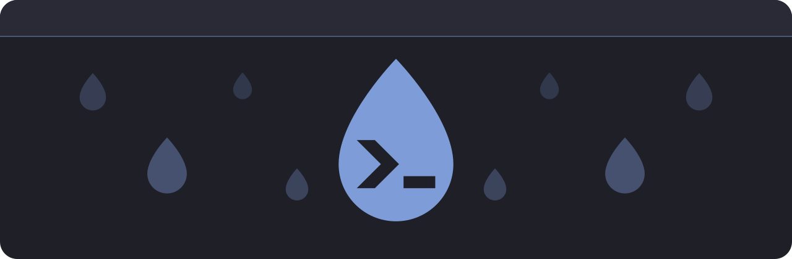

<p align="center"></p>

# Droppy

A native macOS drop-down terminal built on libghostty, the terminal core of Ghostty. A global hotkey slides the panel in from a screen edge and out again.

## Features

- Global hotkey, `ctrl+grave` by default.
- Shows on every Space and over full-screen apps.
- Tabs, with the tab bar at the bottom or top.
- Splits, with optional automatic equalizing.
- Position (top, bottom, left, right, center), alignment and size of the panel.
- Height changes with the mouse (drag the panel's inner edge) and with cmd+j / cmd+k.
- Scrollback search, per pane.
- Bell (`bell-features`), desktop notifications (OSC 9 and 777), command-finished notifications (`notify-on-command-finish`) and tab progress (OSC 9;4).
- Overlay scrollbar (`scrollbar`) and a hovered-link preview.
- Plain-text config with live reload.
- All Ghostty options and themes.

## Requirements

- macOS 14 or later (the declared minimum), Apple Silicon only: the library is built for the native architecture. Tested on macOS 15.
- To build: Xcode with the Metal Toolchain (`xcodebuild -downloadComponent MetalToolchain`), [mise](https://mise.jdx.dev) for Zig 0.17.0 (pinned in `mise.toml`), and [just](https://just.systems).

## Build and install

`Vendor/` is not tracked; the first step creates it.

```sh
mise trust && mise install      # Zig
scripts/build-ghostty.sh        # once: clones Ghostty v1.4.0 and builds libghostty into Vendor/
just build                      # release .app at .build/Droppy.app
just install                    # replaces /Applications/Droppy.app
```

`just install-dir=<path>.app install` (or `DROPPY_INSTALL_DIR`) installs elsewhere. If Droppy is running, install asks it to quit and gives up without changing anything if it does not.

`scripts/build-ghostty.sh ReleaseSmall` builds the library for size instead of speed: the binary is about 20% smaller and terminal throughput about 18% lower in a rough test.

## Configuration

The file is `$XDG_CONFIG_HOME/droppy/config`, or `~/.config/droppy/config`. Lines are `key = value`; `#` starts a comment. Open Config creates the file from a commented template if it does not exist; changes are applied while Droppy runs. Without a file, the defaults apply.

Droppy's own keys:

| Key | Default | Values |
|---|---|---|
| `hotkey` | `ctrl+grave` | modifiers (`ctrl`, `opt`, `cmd`, `shift`) and one key, joined by `+` |
| `position` | `top` | `top`, `bottom`, `left`, `right`, `center` |
| `alignment` | `center` | `start`, `center`, `end` |
| `width` | `100%` | 20% to 100% |
| `height` | `40%` | 15% to 100% |
| `tab-bar` | `bottom` | `bottom`, `top` |
| `hide-on-focus-loss` | `true` | `true`, `false` |
| `border-width` | `1` | points, 0 to 20; 0 turns the border off |
| `border-sides` | `all` | `all`, `none`, or a comma-separated list of `top`, `bottom`, `left`, `right` |
| `border-color` | `auto` | `auto`, `#rrggbb`, `#rrggbbaa` |
| `corner-radius` | `0` | points, 0 to 40; 0 keeps the corners square |
| `corner-radius-corners` | `all` | `all`, `none`, or a comma-separated list of `top-left`, `top-right`, `bottom-left`, `bottom-right` |
| `opacity` | `1` | 0.1 to 1; fades the whole panel including text, tabs and border, unlike Ghostty's `background-opacity` |
| `shadow` | `true` | `true`, `false` |
| `animation-duration` | `0.2` | seconds, 0 to 2 |
| `auto-equalize-splits` | `false` | `true`, `false` |
| `launch-at-login` | `false` | `true`, `false` |

Every other key is passed to Ghostty unchanged, so Ghostty's options, `keybind` and `theme` work as documented by Ghostty. The status-bar menu has Secure Keyboard Entry (also bindable with `keybind = ...=toggle_secure_input`; it is released whenever the panel is hidden or Droppy is inactive), Open Config, Reload Config and Open Config Reference (a read-only copy of the template, which lists Ghostty's options with their defaults). A line that fails to parse is shown in that menu as "Config line N: ...".

```
position = bottom
alignment = end
width = 40%
theme = Kanagawabones
font-size = 14
```

## Shortcuts

These are Ghostty's default macOS bindings, as far as Droppy acts on them, except tab moving, split focus and keeping the panel visible, which Droppy rebinds; change any of them with `keybind`.

| Shortcut | Action |
|---|---|
| ctrl+grave | Show or hide the panel (global; `hotkey`) |
| cmd+t | New tab |
| cmd+1 ... cmd+8, cmd+9 | Go to tab, go to the last tab |
| cmd+shift+[ , cmd+shift+] | Previous, next tab |
| cmd+opt+left, cmd+opt+right | Move the tab left, right (`move_tab:N` moves it by N positions, wrapping around) |
| cmd+opt+p | Keep the panel visible when it loses focus, or hide it again (`toggle_window_float_on_top`); while kept, the border turns to the accent colour (also "Keep Panel Visible" in the right-click menu). Not saved: a config reload restores `hide-on-focus-loss` |
| double-click a tab | Rename it; an empty name restores the automatic title (also `prompt_surface_title`) |
| cmd+w | Close the focused split or tab |
| cmd+opt+w | Close the tab |
| cmd+d, cmd+shift+d | Split right, split down |
| cmd+[ , cmd+] | Previous, next split |
| cmd+shift+arrows | Focus the split in that direction |
| cmd+ctrl+arrows | Resize the split |
| cmd+ctrl+= | Equalize splits |
| cmd+shift+return | Zoom the split |
| cmd+j, cmd+k | Increase, decrease the panel height |
| cmd+c, cmd+v | Copy, paste |
| cmd+=, cmd+-, cmd+0 | Font size larger, smaller, reset |
| double-tap cmd | Jump mode: tabs show a top-row letter (q-p), every split of the tab shows a letter and its directory; press a tab letter to switch tab, a pane letter to focus that split; double-tap cmd or esc leaves it |
| cmd+f | Search the scrollback in the focused pane |
| return, cmd+g | Next match (return only in the search field) |
| shift+return, cmd+shift+g | Previous match (shift+return only in the search field) |
| esc | Close the search and return to the terminal |
| cmd+, | Open config |
| cmd+shift+, | Reload config |
| cmd+z | Undo closing a tab or split, within `undo-timeout`; restores layout and directories, not running processes |
| cmd+q | Quit |

## Known limitations

- Links with custom URL schemes are not opened.
- The app is ad-hoc signed, so Gatekeeper warns on other Macs.
- cmd+k and cmd+j resize the panel; they replace Ghostty's clear-screen and scroll-to-selection.

## Icons

The committed icon assets are in `Resources/`. `scripts/generate-icons.sh` regenerates them from `Resources/icon/*.svg` and is only needed when the artwork changes; it needs an SVG-to-PNG renderer script, given by `ICON_RENDERER`.

## Credits

Built on [Ghostty](https://github.com/ghostty-org/ghostty) by Mitchell Hashimoto and contributors, MIT licensed. Parts of the terminal view code are adapted from its macOS app; see [THIRD_PARTY_NOTICES](THIRD_PARTY_NOTICES).

Droppy is released under the MIT licence, see [LICENSE](LICENSE).
